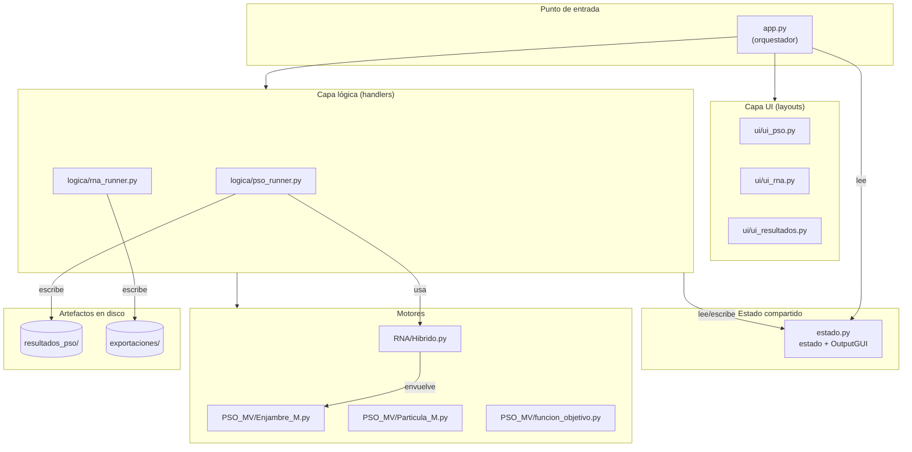

# Arquitectura del proyecto PSO + RNA

> Documento descriptivo de la **estructura estática** del proyecto: cómo está
> dividido, quién hace qué y cómo se comunican las piezas.
>
> No describe flujos paso a paso (ver `WORKFLOWS.md`) ni reglas de uso
> (ver `CONSTRAINTS.md`).

---

## 1. Propósito y alcance

Esta suite es una aplicación de escritorio Python que integra dos motores
algorítmicos en una ventana única con pestañas intercambiables:

- **Optimizador PSO** — Particle Swarm Optimization multi-variable.
- **Constructor RNA** — diseño, entrenamiento y exportación de redes
  neuronales feed-forward.

Los dos motores se comunican de forma unidireccional: un modelo RNA exportado
desde el tab RNA puede usarse como función objetivo del PSO.

**Alcance del documento**: describe los módulos, sus responsabilidades, las
reglas de dependencia entre capas, el estado compartido y las convenciones
de nomenclatura. No cubre:

- Sintaxis ni validación de entradas (→ `CONSTRAINTS.md`).
- Secuencias operativas de cada flujo (→ `WORKFLOWS.md`).
- Instalación, dependencias y ejecución (→ `README.md`).

**Principio rector de diseño**: el proyecto se concibe desde el inicio para
ser empaquetable como **ejecutable único portátil**. Esto implica que toda
referencia a recursos debe ser relativa al ejecutable o al directorio de
trabajo del usuario, nunca absoluta ni dentro del bundle.

---

## 2. Vista general del sistema

### 2.1 Diagrama de bloques



### 2.2 Enrutamiento de eventos

El bucle principal reside en `app.py`. PySimpleGUI emite un evento por cada
interacción; `app.py` lo enruta según el prefijo de la clave:

| Prefijo | Se envía a | Ejemplo |
|---|---|---|
| `pso-` | `logica/pso_runner.handle()` | `pso-INI-` |
| `rna-` | `logica/rna_runner.handle()` | `rna-GENERAR-` |
| `res-` | Manejado directamente en `app.py` | `res-GUARDAR_PNG-` |

Los handlers devuelven uno de estos valores, que `app.py` interpreta:

- `None` → nada que hacer.
- `'REBUILD'` → reconstruir la ventana (por ejemplo al cambiar `NV`).
- `'IR_A_RNA'` → cambiar de tab programáticamente.

---

## 3. Módulos y reglas de dependencia

### 3.1 Responsabilidades por archivo

| Archivo | Rol | Expone |
|---|---|---|
| `app.py` | Orquestador: abre la ventana, enruta eventos, redirige `stdout`/`stderr` | `main()` |
| `estado.py` | Singleton de estado compartido + `OutputGUI` (redirección de streams) | `estado`, `OutputGUI` |
| `ui/ui_pso.py` | Layout del tab *Optimizador PSO* | `layout_pso(nv, defaults)` |
| `ui/ui_rna.py` | Layout del tab *Constructor RNA* | `layout_rna()` |
| `ui/ui_resultados.py` | Layout del tab *Resultados* | `layout_resultados()` |
| `logica/pso_runner.py` | Handlers del tab PSO + gráfica + guardado PNG + edición config | `handle()`, `actualizar_grafica()`, `guardar_grafica_png()`, `redibujar_resultados()` |
| `logica/rna_runner.py` | Handlers del tab RNA: entrenamiento, predicción, importación CSV, exportación de modelo | `handle()` |
| `PSO_MV/Enjambre_M.py` | Motor del enjambre: evalúa, mueve, itera, guarda historial | clase `enjambre` |
| `PSO_MV/Particula_M.py` | Partícula individual: posición, velocidad, mejor local | clase `particula` |
| `PSO_MV/funcion_objetivo.py` | Parser seguro (`ast`) de expresiones matemáticas | `crear_funcion_objetivo()` |
| `RNA/Hibrido.py` | Carga un modelo RNA exportado y devuelve una `callable` apta para el PSO | `cargar_funcion_prediccion()` |
 `logica/rutas.py` | Centraliza rutas de datos (cwd o home según modo) | carpeta_datos(), carpeta_resultados_pso(), carpeta_exportaciones(), archivo_historial() |

### 3.2 Reglas de dependencia

Se respetan de forma estricta. Cada módulo solo puede importar de las capas
que aparecen a su derecha:

```
app.py       →  ui/, logica/, estado
ui/          →  FreeSimpleGUI únicamente
logica/      →  PSO_MV/, RNA/, estado
PSO_MV/      →  numpy, pandas, copy, time   (sin dependencias del proyecto)
RNA/         →  PSO_MV/funcion_objetivo, tensorflow, joblib, numpy
estado.py    →  PySimpleGUI únicamente
```

**Reglas específicas**:

- La capa `ui/` **nunca** importa de `logica/`, `PSO_MV/` ni `RNA/`. Solo
  declara layouts y devuelve listas de listas de widgets.
- La capa `logica/` **nunca** crea ventanas. Solo manipula la ventana recibida
  como parámetro.
- `PSO_MV/` es autocontenido: podría extraerse a un paquete independiente sin
  tocar el resto del proyecto.
- `RNA/Hibrido.py` es el **único** punto de acoplamiento entre la parte RNA
  y la parte PSO.

---

## 4. Estado compartido

Vive como singleton en `estado.py`. Es el mecanismo por el que las pestañas
intercambian información sin acoplarse directamente.

| Campo | Tipo | Escrito por | Leído por |
|---|---|---|---|
| `nv` | `int` | `pso_runner` (al pulsar *Actualizar* o cargar RNA) | `layout_pso`, `pso_runner` |
| `defaults` | `dict` | `pso_runner`, `rna_runner` | `pso_runner` |
| `funcion_objetivo_rna` | `Callable \| None` | `pso_runner` (cargar/quitar modelo) | `pso_runner._ejecutar_pso` |
| `ruta_rna` | `str \| None` | `pso_runner` | `pso_runner` |
| `ultima_figura` | `Figure \| None` | `pso_runner.actualizar_grafica` | `pso_runner.guardar_grafica_png`, `redibujar_resultados` |
| `ultimo_dtframe` | `DataFrame \| None` | `pso_runner.actualizar_grafica` | `pso_runner` |
| `rna_datos_importados` | `dict \| None` | `rna_runner` | `rna_runner` |
| `rna_modelo` | `keras.Model \| None` | `rna_runner` | `rna_runner` |
| `rna_escalador_x`, `rna_escalador_y` | `StandardScaler \| None` | `rna_runner` | `rna_runner` |
| `rna_X_validacion`, `rna_y_validacion` | `ndarray \| None` | `rna_runner` | `rna_runner` |
| `rna_nv` | `int \| None` | `rna_runner` | `rna_runner` |
| `rna_lim_inf_global`, `rna_lim_sup_global` | `list \| None` | `rna_runner` | `rna_runner` |
| `rna_columnas_x_global` | `list \| None` | `rna_runner` | `rna_runner` |

### Ciclo de vida

- `estado` se instancia **una sola vez** al importar el módulo. Persiste
  durante toda la sesión, incluyendo los `REBUILD` de la ventana.
- Los campos `pso-*` se mantienen entre reconstrucciones. Los campos `rna-*`
  solo se reinicializan al arrancar la aplicación.
- `funcion_objetivo_rna` y `ruta_rna` se limpian al pulsar *Quitar modelo*.
- Al pulsar *Limpiar Datos* en el tab PSO, se resetean `nv`, `defaults` y
  los campos de RNA asociados al modelo cargado.

---

## 5. Convenciones estructurales

Reglas de nomenclatura aplicadas de forma consistente en todo el proyecto.

### 5.1 Prefijos de claves (widgets)

| Prefijo | Ámbito |
|---|---|
| `pso-` | Tab *Optimizador PSO* |
| `rna-` | Tab *Constructor RNA* |
| `res-` | Tab *Resultados* |

**Obligatorio**. Sin prefijo, las claves colisionan entre tabs y el
enrutamiento por prefijo en `app.py` falla.

### 5.2 Nombres de carpetas

```
ui/              Layouts (solo widgets)
logica/          Handlers y runners
PSO_MV/          Motor del PSO (autocontenido)
RNA/             Puente hacia modelos RNA exportados
docs/            Documentación estructural
tests/           Pruebas automáticas (pendiente)
resultados_pso/  Salidas del PSO (ignorada por Git)
exportaciones/   Modelos RNA exportados (ignorada por Git)
dist/            Salida del empaquetado PyInstaller (ignorada por Git)
build/           Archivos temporales de PyInstaller (ignorada por Git)
```

### 5.3 Archivos generados en tiempo de ejecución

| Carpeta | Archivos |
|---|---|
| `resultados_pso/` | `Historial_Enjambre.csv`, `grafica_enjambre.png` |
| `exportaciones/<nombre>/` | `modelo.keras`, `scaler_x.save`, `scaler_y.save`, `config.json` |

Ambas carpetas están en `.gitignore`. No forman parte del código fuente.

### 5.4 Prefijos de ramas Git

| Prefijo | Uso |
|---|---|
| `feature/` | Funcionalidad nueva |
| `fix/` | Corrección de bug |
| `docs/` | Solo documentación |
| `refactor/` | Reorganización sin cambio de comportamiento |

### 5.5 Formato de commits

Estilo libre descriptivo en español, en modo imperativo:

```
Añade guardado de gráfica PNG en el tab Resultados
Corrige colisión de claves entre tabs mediante prefijos
```

Sin prefijos obligatorios por ahora. Se podrá formalizar más adelante si el
proyecto crece en complejidad.