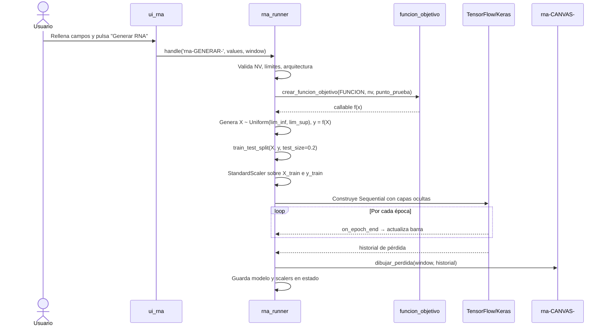
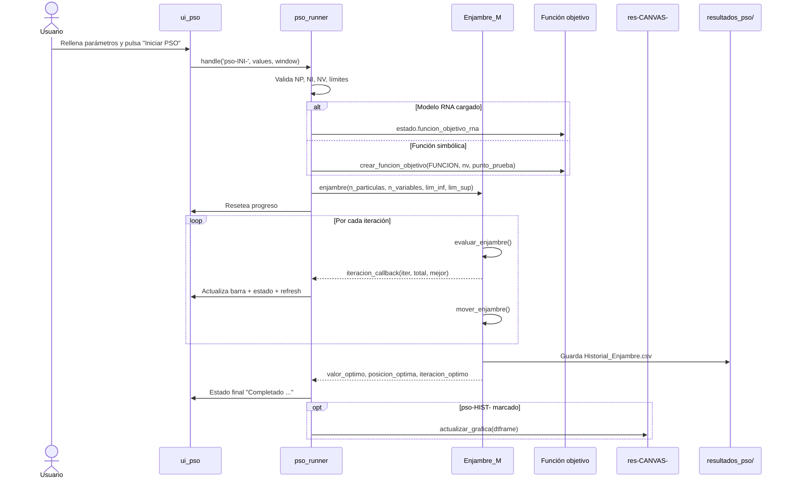

# Flujos de trabajo del proyecto PSO + RNA

> Documento descriptivo de los **flujos dinámicos** del sistema: qué ocurre,
> en qué orden y con qué efectos, desde que el usuario interactúa hasta que
> el sistema responde.
>
> No describe estructura estática (ver `ARCHITECTURE.md`) ni reglas de uso
> (ver `CONSTRAINTS.md`).

---

## Índice de flujos

1. [Arranque de la aplicación y salida](#1-arranque-de-la-aplicación-y-salida)
2. [Importar CSV de datos para RNA](#2-importar-csv-de-datos-para-rna)
3. [Entrenar RNA desde datos sintéticos](#3-entrenar-rna-desde-datos-sintéticos)
4. [Entrenar RNA desde CSV importado](#4-entrenar-rna-desde-csv-importado)
5. [Exportar el modelo RNA](#5-exportar-el-modelo-rna)
6. [Cargar modelo RNA en el tab PSO](#6-cargar-modelo-rna-en-el-tab-pso)
7. [Ejecutar el PSO](#7-ejecutar-el-pso)
   - 7.A [Controles Avanzados](#7a-controles-avanzados-subapartado)
8. [Editar el `config.json` del modelo cargado](#8-editar-el-configjson-del-modelo-cargado)
9. [Guardar la gráfica como PNG](#9-guardar-la-gráfica-como-png)
10. [Importar / exportar CSV de parámetros del PSO](#10-importar--exportar-csv-de-parámetros-del-pso)
11. [Cambio de NV y reconstrucción de ventana](#11-cambio-de-nv-y-reconstrucción-de-ventana)

---

## Convenciones del documento

Cada flujo sigue el mismo esqueleto:

- **Disparador**: qué inicia el flujo.
- **Precondiciones**: qué debe cumplirse antes.
- **Entradas**: de dónde sale cada dato.
- **Salidas / efectos**: qué cambia (estado, disco, UI).
- **Pasos**: secuencia numerada y detallada.
- **Errores importantes**: casos que interrumpen o alertan al usuario.

---

## 1. Arranque de la aplicación y salida

**Disparador**: el usuario ejecuta `python app.py` o hace doble clic sobre el
ejecutable empaquetado.

**Precondiciones**: dependencias instaladas (`PySimpleGUI`, `tensorflow`,
`scikit-learn`, `joblib`, `matplotlib`, `pandas`, `numpy`).

**Entradas**: ninguna.

**Salidas / efectos**: ventana principal visible con tres pestañas. `stdout` y
`stderr` redirigidos al multiline del tab *Resultados*.

### Pasos

1. `app.main()` invoca `_build_window()`, que construye tres layouts:
   - `ui_pso.layout_pso(estado.nv, estado.defaults)`
   - `ui_rna.layout_rna()`
   - `ui_resultados.layout_resultados()`
2. Los tres layouts se envuelven en un `sg.TabGroup` con clave `-TABS-` y se
   crea el `sg.Window` con `resizable=True` y `finalize=True`.
3. Se llama a `window.maximize()` para ocupar la pantalla completa.
4. Se instancian dos `OutputGUI` y se asignan a `sys.stdout` y `sys.stderr`,
   apuntando a `res-OUTPUT-`. A partir de aquí, cualquier `print` del sistema
   (incluidos los de TensorFlow) aparece en el tab Resultados.
5. Se entra al bucle principal: `while True: event, values = window.read()`.
6. Cada evento es enrutado:
   - Si empieza con `pso-` → `pso_runner.handle(event, values, window)`.
   - Si empieza con `rna-` → `rna_runner.handle(event, values, window)`.
   - Si empieza con `res-` o es un evento especial → manejado en `app.py`.

### Formas de salir

- Botón **Cerrar** del tab PSO (clave `pso-CERRAR-`).
- Botón **Salir** del tab RNA (clave `rna-SALIR-`).
- Cierre de la ventana con la X del sistema operativo (`sg.WIN_CLOSED`).
- Cualquiera de las tres rompe el bucle y llama a `window.close()`.

### Errores importantes

- Si falta una dependencia, el `import` inicial falla con `ModuleNotFoundError`
  antes de abrir la ventana. El usuario ve el error en la terminal.
- Si el backend Tk de matplotlib no está disponible, `FigureCanvasTkAgg` falla
  al primer intento de dibujar, no al arrancar. El popup de error del flujo
  correspondiente lo reporta.

---

## 2. Importar CSV de datos para RNA

**Disparador**: botón **Importar Datos** en el tab RNA (clave `rna-IMPORTAR-`).

**Precondiciones**: existe un archivo CSV con al menos una columna de entrada
y una columna objetivo.

**Entradas**: ruta del CSV elegida en `sg.popup_get_file`.

**Salidas / efectos**:

- `estado.rna_datos_importados` = `{'X', 'y', 'archivo', 'columnas_x'}`.
- `estado.rna_nv` = número de columnas de `X`.
- UI: el combo `rna-COL_Y-` se puebla con las columnas disponibles.
- UI: se activa el radio `rna-MODO-IMPORTADO-` y se ocultan los campos de
  datos sintéticos (`rna-FRAME-0-`).

### Pasos

1. Usuario pulsa **Importar Datos**.
2. `sg.popup_get_file` abre un diálogo filtrando por `*.csv`.
3. Si el usuario cancela, el flujo termina sin efectos.
4. `pd.read_csv(archivo)` carga el CSV en un DataFrame.
5. Se verifica que el DataFrame no esté vacío.
6. Se determina la columna objetivo: la que esté seleccionada en `rna-COL_Y-`
   o, si no hay selección, la **última columna** del DataFrame.
7. Se verifica que la columna objetivo exista en el DataFrame.
8. Se separa `y = df[col_y]` y `X = df.drop(columns=[col_y])`.
9. Se verifica que `X` tenga al menos una columna.
10. Se verifica que ni `X` ni `y` contengan `NaN`.
11. Se guarda en `estado.rna_datos_importados` con la lista de columnas de
    entrada (`columnas_x`) además de `X` y `y`.
12. Se actualiza la UI:
    - `rna-COL_Y-` recibe todas las columnas del CSV.
    - `rna-MODO-IMPORTADO-` se activa.
    - `rna-FRAME-0-` se oculta (datos sintéticos).
    - `rna-FRAME-4-` se muestra (datos importados).
    - `rna-ESTADO-` muestra un resumen: número de muestras, número de
      entradas y nombre de la columna objetivo.

### Errores importantes

- **CSV vacío** → popup `"El archivo CSV está vacío."`. No se modifica el
  estado.
- **Columna objetivo inexistente** → popup con el nombre de la columna. No
  se modifica el estado.
- **Sin columnas de entrada** → popup `"El CSV debe tener al menos una
  columna de entrada además de la salida."`.
- **NaNs en los datos** → popup indicando valores faltantes.
- **Excepción genérica** (permisos, encoding) → popup con el mensaje; se
  resetea `estado.rna_datos_importados = None`.

---

## 3. Entrenar RNA desde datos sintéticos

**Disparador**: botón **Generar RNA** en el tab RNA (clave `rna-GENERAR-`),
con el radio `rna-MODO-SINTETICO-` activo.

**Precondiciones**: los campos `rna-NV-`, `rna-LIM_INF-`, `rna-LIM_SUP-`,
`rna-FUNCION-` y los parámetros de arquitectura están rellenos.

**Entradas**: función objetivo simbólica, límites, muestras, arquitectura.

**Salidas / efectos**:

- `estado.rna_modelo`, `rna_escalador_x`, `rna_escalador_y`,
  `rna_X_validacion`, `rna_y_validacion`, `rna_nv`,
  `rna_lim_inf_global`, `rna_lim_sup_global`, `rna_columnas_x_global`.
- Gráfica de pérdida en `rna-CANVAS-`.
- UI: barra de progreso `rna-PROGRESO-` y porcentaje `rna-PORCENTAJE-`.

### Diagrama de secuencia

### Pasos

1. `rna_runner.handle()` recibe `rna-GENERAR-`.
2. Se verifica que el modo sea sintético (`rna-MODO-IMPORTADO-` = `False`).
3. Se valida `nv = int(rna-NV-)`, `lim_inf` y `lim_sup` (parseados desde
   texto separado por comas).
4. Se verifica que `nv ≥ 1`, que `len(lim_inf) == nv` y `len(lim_sup) == nv`.
5. Se verifica que `lim_inf[i] < lim_sup[i]` para toda `i`.
6. Se guarda en estado `rna_lim_inf_global`, `rna_lim_sup_global`,
   `rna_columnas_x_global`.
7. `punto_prueba = (lim_inf + lim_sup) / 2`.
8. `funcion_objetivo = modulo_funcion_objetivo.crear_funcion_objetivo(...)`.
   Esto valida sintaxis y dominio.
9. Se lee arquitectura: `capas`, `neuronas`, `activacion`.
10. Se verifica que `len(neuronas) == capas` y que todos los valores son
    positivos.
11. Se lee `epocas`, `batch`, `muestras`. Todos deben ser `≥ 1`.
12. Se generan `muestras` puntos aleatorios uniformes en `[lim_inf, lim_sup]`
    y se evalúa la función objetivo en cada uno.
13. `train_test_split(X, y, test_size=0.2, random_state=42)`.
14. Se ajustan dos `StandardScaler`: uno para `X` y otro para `y`.
15. Se construye el modelo `Sequential`:
    - `layers.Input(shape=(nv,))`.
    - Una capa `Dense` por cada valor en `neuronas`, con `activacion`.
    - Capa final `Dense(1)` sin activación.
    - `compile(optimizer='adam', loss='mean_squared_error')`.
16. Se resetea la barra: `rna-PROGRESO-` a 0 con máximo `epocas`.
17. Se entrena con un callback `ActualizarProgreso` que en cada `on_epoch_end`
    actualiza barra, porcentaje y estado, y fuerza `window.refresh()`.
18. Al terminar, `dibujar_perdida(window, historial)` incrusta la curva en
    `rna-CANVAS-`.
19. Se persisten el modelo, los escaladores, los datos de validación y `nv`
    en `estado`.
20. `rna-ESTADO-` muestra `"Entrenamiento finalizado."`.

### Errores importantes

- **nv ≠ cantidad de límites** → popup `"El número de variables debe
  coincidir con la cantidad de límites."`.
- **`lim_inf[i] ≥ lim_sup[i]`** → popup `"Cada límite inferior debe ser
  menor que su límite superior."`.
- **Función objetivo inválida** (sintaxis o dominio) → popup con el mensaje
  que devuelve `crear_funcion_objetivo`.
- **Neuronas ≠ capas** → popup `"El numero de neuronas debe coincidir con
  el numero de capas."`.
- **Valores no positivos** → popup `"Las capas y las neuronas deben ser
  mayores que cero."` o equivalente para épocas/batch/muestras.
- **Error durante `fit`** (por ejemplo, forma incompatible) → popup
  `"Error durante el entrenamiento: ..."`. El estado queda a medias.

---

## 4. Entrenar RNA desde CSV importado

**Disparador**: botón **Generar RNA** con el radio `rna-MODO-IMPORTADO-`
activo.

**Precondiciones**: el flujo 2 se ha ejecutado con éxito;
`estado.rna_datos_importados` no es `None`.

**Entradas**: `estado.rna_datos_importados['X']`, `['y']` y la arquitectura
introducida por el usuario.

**Salidas / efectos**: idénticas al flujo 3, excepto que no se genera `X` ni
`y` sintéticos y no se toca `rna_lim_inf_global` ni `rna_lim_sup_global`
(se derivarán al exportar).

### Pasos

1. `rna_runner.handle()` recibe `rna-GENERAR-`.
2. Se verifica que `estado.rna_datos_importados` no sea `None`. Si lo es,
   popup `"Importe un archivo CSV antes de generar la RNA."` y termina.
3. Se recuperan `X`, `y`, `nv = X.shape[1]`.
4. Se leen y validan los parámetros de arquitectura (mismos controles que
   en el flujo 3, pasos 9-11).
5. `train_test_split`, escalado, construcción del modelo, entrenamiento y
   guardado en estado: **idénticos** al flujo 3 desde el paso 13.
6. `dibujar_perdida` en `rna-CANVAS-`.
7. `rna-ESTADO-` muestra `"Entrenamiento finalizado."`.

### Errores importantes

- **Sin CSV importado** → popup bloqueante, no continúa.
- Los demás errores (arquitectura inválida, fallo de `fit`) se manejan igual
  que en el flujo 3.

---

## 5. Exportar el modelo RNA

**Disparador**: botón **Exportar Modelo** en el tab RNA (clave `rna-EXPORTAR-`).

**Precondiciones**: `estado.rna_modelo` no es `None` (se ha entrenado al
menos una vez).

**Entradas**: carpeta elegida por el usuario mediante `sg.popup_get_folder`.

**Salidas / efectos**: se escriben cuatro archivos en
`<carpeta_elegida>/`:

- `modelo.keras`
- `scaler_x.save`
- `scaler_y.save`
- `config.json` (con `tipo`, `version`, `nv`, límites, columnas y bloque `pso`)

### Pasos

1. Si `estado.rna_modelo is None` → popup
   `"Primero entrene o genere la RNA antes de exportar."` y termina.
2. Se determina el origen de los límites y columnas:
   - **Modo importado**: `lim_inf = X.min(axis=0)`, `lim_sup = X.max(axis=0)`,
     `nv_exp = X.shape[1]`, `columnas_exp = rna_datos_importados['columnas_x']`.
   - **Modo sintético**: `lim_inf = rna_lim_inf_global`, `lim_sup = rna_lim_sup_global`,
     `nv_exp = rna_nv`, `columnas_exp = rna_columnas_x_global`.
3. `sg.popup_get_folder` pide la carpeta destino.
4. Si el usuario cancela, termina sin efectos.
5. `Path(carpeta).mkdir(parents=True, exist_ok=True)`.
6. `estado.rna_modelo.save(carpeta / 'modelo.keras')`.
7. `jb.dump(estado.rna_escalador_x, carpeta / 'scaler_x.save')`.
8. `jb.dump(estado.rna_escalador_y, carpeta / 'scaler_y.save')`.
9. Se construye el `config.json`:
   - `tipo`: `"RNA"`.
   - `version`: `1`.
   - `nv`: entero.
   - `lim_inf`, `lim_sup`: listas de floats.
   - `columnas_x`: lista de strings.
   - `pso`: bloque con `NP`, `NI`, `OPT`, `W_I`, `W_F`, `C1`, `C2`,
     `RONDAS`, `TOL`, `RED_W`, `P_T`. Valores sugeridos por defecto.
10. Se escribe el JSON con `indent=2` y `ensure_ascii=False`.
11. Popup informativo con la ruta de la carpeta.
12. `rna-ESTADO-` muestra `"Modelo exportado en <ruta>"`.

### Errores importantes

- **Sin modelo entrenado** → popup bloqueante.
- **Sin límites conocidos** (sintético sin haber entrenado) → popup
  `"No se encontraron los límites de las variables."`.
- **Sin datos importados** en modo importado → popup.
- **Error de escritura** (permisos, disco lleno) → popup con el mensaje de
  la excepción.

---

## 6. Cargar modelo RNA en el tab PSO

**Disparador**: botón **Cargar modelo RNA** en el tab PSO
(clave `pso-CARGAR_RNA-`).

**Precondiciones**: el campo `pso-RUTA_RNA-` contiene una ruta a una carpeta
que fue exportada previamente por el flujo 5.

**Entradas**: ruta de la carpeta.

**Salidas / efectos**:

- `estado.funcion_objetivo_rna` = `callable f(x) -> float`.
- `estado.ruta_rna` = ruta de la carpeta.
- `estado.nv` = `nv` del `config.json`.
- `estado.defaults` actualizado con `NP`, `NI`, `OPT`, `W_I`, `W_F`, `C1`,
  `C2`, `RONDAS`, `TOL`, `RED_W`, `P_T` del bloque `pso` del JSON.
- UI: `pso-INFO_RNA-` muestra resumen del modelo; `pso-PIN_EDITAR-` se
  muestra.
- `REBUILD` para que el formulario refleje los valores actualizados.

### Pasos

1. Se determina la ruta del modelo:
   - Si el `ComboBox` tiene un valor que coincide con un `display` conocido,
     se resuelve a la ruta de ese modelo.
   - Si no, se trata como ruta manual (escrita a mano o vía FolderBrowse).
   - Si ambas están vacías, popup de error.
2. Se llama a `Hibrido.cargar_funcion_prediccion(ruta)`:
   - Verifica existencia de `modelo.keras`, `scaler_x.save`,
     `scaler_y.save`, `config.json`.
   - Carga el modelo con `tf.keras.models.load_model`.
   - Carga los dos `StandardScaler` con `jb.load`.
   - Lee `nv`, `lim_inf`, `lim_sup` del JSON.
   - Devuelve una función `f(x)` que aplica escalado, predice y desescala.
3. Se guardan `funcion_objetivo_rna` y `ruta_rna` en `estado`.
4. Se guardan `lim_inf[i]` y `lim_sup[i]` en `defaults` bajo
   `pso-MIN-i-` y `pso-MAX-i-`.
5. Se intenta leer el bloque `pso` del `config.json`. Si existe, se mapean
   sus claves a las claves del formulario (`NP` → `pso-NP-`, etc.).
   Si no existe, se dejan los defaults actuales.
6. `pso-INFO_RNA-` muestra la ruta, el `nv`, los límites y un mensaje
   indicando que se usará el modelo como función objetivo.
7. `pso-PIN_EDITAR-` se hace visible.
8. Se resetea el panel de progreso: `pso-ESTADO-` a
   `"Modelo RNA listo. Pulsa 'Iniciar PSO'."`, `pso-PROGRESO-` a 0.
9. Se devuelve `'REBUILD'` para reconstruir la ventana.

### Errores importantes

- **Archivo faltante en la carpeta** → `Hibrido` lanza `FileNotFoundError`;
  popup con el archivo concreto que falta.
- **`config.json` corrupto** → popup con el mensaje de `json.JSONDecodeError`.
- **`config.json` con `tipo` incorrecto** → popup indicando que no es un
  modelo RNA.
- **Modelo incompatible con Keras actual** → excepción durante
  `load_model`; popup con el mensaje.

  ### 6.A Selección del modelo desde la lista

**Disparador**: cambio de pestaña al tab PSO con una exportación reciente,
o pulsación del botón `⟳`.

**Precondiciones**: ninguna.

**Entradas**: sistema de archivos del proyecto.

**Salidas / efectos**: el `ComboBox` `pso-MODELO_COMBO-` se puebla con
los modelos encontrados; si el usuario acaba de exportar uno desde el
tab RNA, queda seleccionado automáticamente.

**Pasos**

1. `buscador_modelos.buscar_modelos_disponibles()` escanea el proyecto
   con `rglob('config.json')`.
2. Se descartan las carpetas conocidas (`PSO_MV`, `RNA`, `ui`, `logica`,
   `tests`, `resultados_pso`, `.git`, entornos virtuales).
3. Se descartan los `config.json` cuyo campo `tipo` no sea `"RNA"`.
4. Se descartan los modelos incompletos (falta `modelo.keras`,
   `scaler_x.save` o `scaler_y.save`).
5. Los modelos válidos se ordenan por `mtime` descendente.
6. El `ComboBox` recibe la lista de `display` strings, formato
   `"<nombre> — nv=<n> | <dd/mm HH:MM>"`.
7. Si no hay modelos, el multiline `pso-INFO_RNA-` muestra un mensaje
   indicando que se exporte uno o se use "Examinar…".

---

## 7. Ejecutar el PSO

**Disparador**: botón **Iniciar PSO** (clave `pso-INI-`).

**Precondiciones**: los campos del tab PSO están completos y válidos. Si no
hay modelo RNA cargado, `pso-FUNCION-` contiene una expresión válida.

**Entradas**:

- `pso-NP-`, `pso-NI-`, `pso-NV-`.
- `pso-MIN-i-`, `pso-MAX-i-` para `i` en `[0, nv)`.
- `pso-FUNCION-` (si no hay modelo RNA).
- `pso-OPT-`, `pso-D_W-`, `pso-P_T-`, `pso-HIST-`.
- Controles avanzados desde `estado.defaults`.

**Salidas / efectos**:

- `resultados_pso/Historial_Enjambre.csv`.
- Gráfica en `res-CANVAS-` si `pso-HIST-` está marcado.
- Barra y estado finales en el panel de progreso.
- `estado.ultima_figura` y `estado.ultimo_dtframe` actualizados.

### Diagrama de secuencia

### Pasos

1. `pso_runner.handle()` recibe `pso-INI-`.
2. Se convierten `NP`, `NI`, `NV` a enteros. Fallo de conversión → popup.
3. Se recorren `nv` variables: se leen `MIN-i-` y `MAX-i-` como floats, se
   verifica `lim_inf[i] < lim_sup[i]`. Fallo → popup con el índice.
4. `punto_prueba = (lim_inf + lim_sup) / 2`.
5. Se decide la función objetivo:
   - Si `estado.funcion_objetivo_rna is not None` → esa.
   - Si no → `crear_funcion_objetivo(pso-FUNCION-, nv, punto_prueba)`.
6. Se leen controles avanzados desde `estado.defaults`: `W_I`, `W_F`, `C1`,
   `C2`, `RONDAS`, `TOL`, `RED_W`, `P_T`.
7. Se valida `RONDAS ≥ 1`, `C1 ≥ 0`, `C2 ≥ 0`. Fallo → popup.
8. Se resetea el panel de progreso: barra al 0% con máximo `NI`, estado
   `"Iniciando PSO (<origen>) ..."`, `window.refresh()`.
9. Se define un callback `_on_iteracion(actual, total, mejor)` que:
   - Calcula el porcentaje.
   - Actualiza `pso-PROGRESO-`, `pso-PORCENTAJE-`, `pso-ESTADO-`.
   - Llama a `window.refresh()`.
   - Está envuelto en `try/except` para no abortar el PSO si la UI falla.
10. Se instancia `Enjambre_M.enjambre(...)` con `n_particulas`, `nv`,
    `lim_inf`, `lim_sup`.
11. Se llama a `enj.optimizar(...)` pasando:
    - `n_iteraciones`, `optimizacion`, `funcion_objetivo`.
    - `w_i`, `w_f`, `c1`, `c2`, `reduccion_w`.
    - `parada_temprana`, `rondas_parada`, `tolerancia`.
    - `carpeta_salida="resultados_pso"`.
    - `iteracion_callback=_on_iteracion`.
12. El enjambre:
    - Evalúa cada partícula.
    - Registra historial de mejor valor y mejor posición.
    - Invoca el callback.
    - Aplica reducción de inercia.
    - Mueve las partículas.
    - Actualiza `self.dtframe`.
    - Repite hasta agotar iteraciones o disparar parada temprana.
13. El enjambre escribe `resultados_pso/Historial_Enjambre.csv`.
14. El enjambre imprime en `stdout` (visible en `res-OUTPUT-`) tiempo total,
    iteración óptima, mejor valor y mejores coordenadas.
15. Al terminar, `pso_runner` actualiza el panel de progreso:
    estado `"Completado (X iters) — mejor valor: Y"`, barra al 100%.
16. Si `pso-HIST-` está marcado, se llama a `actualizar_grafica(window,
    enj.dtframe)`, que:
    - Construye una figura matplotlib.
    - La guarda en `estado.ultima_figura` y `estado.ultimo_dtframe`.
    - La incrusta en `res-CANVAS-`.

### Comportamiento durante la ejecución

- La barra avanza proporcionalmente a `iteración / NI`.
- El estado muestra en todo momento `"Iteración X/N — mejor valor: V"`.
- `window.refresh()` en cada iteración permite que la GUI se repinte.
- El bucle de PySimpleGUI está bloqueado durante la ejecución; el usuario
  no puede interactuar con la ventana hasta que termine.
- Los `print` del enjambre aparecen progresivamente en `res-OUTPUT-`.

### Errores importantes

- **Límites incoherentes** → popup indicando el índice de la variable.
- **Función objetivo inválida** → popup con el mensaje de
  `crear_funcion_objetivo`.
- **Partícula fuera del dominio** de la función objetivo (log, sqrt) → el
  enjambre lanza `ValueError`; `pso_runner` lo captura y muestra
  `"Una partícula salió del dominio permitido de la función objetivo."`.
  El estado del panel queda en `"Error durante la ejecución."`.
- **Parada temprana alcanzada** → no es error. El bucle del enjambre rompe,
  imprime `"Se ha alcanzado la condición de parada temprana en la iteración X"`,
  y el panel muestra el estado de completado con el número real de
  iteraciones.

### 7.A Controles Avanzados (subapartado)

**Disparador**: botón **Controles Avanzados** (`pso-CONTROLES-`).

**Precondiciones**: ninguna.

**Entradas**: los valores de `estado.defaults`.

**Salidas / efectos**: `estado.defaults` actualizado si el usuario pulsa
**Guardar**. La ventana principal permanece abierta; el diálogo es modal.

**Pasos**

1. Se construye un `sg.Window` secundario con los campos `W_I`, `W_F`,
   `C1`, `C2`, `RONDAS`, `TOL`.
2. Se prerrellenan con `estado.defaults`.
3. Bucle local de lectura del diálogo.
4. **Guardar** → `estado.defaults.update(vals)`; se cierra el diálogo.
5. **Restablecer** → se cargan los valores por defecto en los campos del
   diálogo (no en `defaults` hasta guardar).
6. **Cerrar** o cierre del diálogo → se cierra sin tocar `estado`.

**Errores importantes**: ninguno. El diálogo no valida; la validación real
ocurre al ejecutar el PSO (flujo 7, paso 7).

---

## 8. Editar el `config.json` del modelo cargado

**Disparador**: botón **Editar config PSO del modelo** (`pso-EDITAR_CONFIG-`).

**Precondiciones**: `estado.ruta_rna` no es `None` (hay un modelo cargado).

**Entradas**: bloque `pso` del `config.json` del modelo.

**Salidas / efectos**:

- `estado.defaults` actualizado.
- Opcionalmente, `config.json` reescrito en disco.
- `REBUILD` para reflejar cambios en el formulario.

### Pasos

1. Si `estado.ruta_rna is None` → popup
   `"No hay modelo RNA cargado. Cárguelo primero."` y termina.
2. Se lee `config.json`. Si falla, popup con el error y termina.
3. Se construye un diálogo con campos:
   `cfg-NP-`, `cfg-NI-`, `cfg-OPT-`, `cfg-W_I-`, `cfg-W_F-`, `cfg-C1-`,
   `cfg-C2-`, `cfg-RONDAS-`, `cfg-TOL-`, `cfg-RED_W-`, `cfg-P_T-`.
4. Se prerrellenan con el bloque `pso` actual o con valores por defecto si
   no existe.
5. El usuario elige una de tres acciones:
   - **Guardar en config.json** → aplica a `defaults` y reescribe el JSON.
   - **Aplicar sin guardar** → solo aplica a `defaults`.
   - **Cancelar** → termina sin efectos.
6. Al aplicar, se validan los valores:
   - `NP ≥ 1`, `NI ≥ 1`, `RONDAS ≥ 1`.
   - `OPT ∈ {'Minimización', 'Maximización'}`.
   - `C1 ≥ 0`, `C2 ≥ 0`, `TOL > 0`.
7. Se actualizan `estado.defaults` con las claves `pso-*` correspondientes.
8. Si la acción fue **Guardar**, se reescribe `config.json` con el bloque
   `pso` actualizado, manteniendo el resto intacto.
9. Se devuelve `'REBUILD'` para que el formulario del tab PSO refleje los
   nuevos valores.

### Errores importantes

- **Sin modelo cargado** → popup bloqueante.
- **JSON corrupto** → popup con la línea y columna del error.
- **Valores inválidos** (por ejemplo, `NP = 0`) → popup detallando el
  campo y la restricción. El `config.json` no se modifica.
- **Fallo al escribir** (permisos) → popup con el mensaje. `estado.defaults`
  **sí** se actualiza aunque el JSON no.

---

## 9. Guardar la gráfica como PNG

**Disparador**: botón **Guardar gráfica (PNG)** (`res-GUARDAR_PNG-`).

**Precondiciones**: `estado.ultima_figura` no es `None` (se ha ejecutado el
PSO con `pso-HIST-` marcado al menos una vez).

**Entradas**: `estado.ultima_figura` (objeto `Figure` de matplotlib).

**Salidas / efectos**: archivo `resultados_pso/grafica_enjambre.png`.

### Pasos

1. Si `estado.ultima_figura is None` → popup
   `"Todavía no hay gráfica para guardar."` y termina.
2. `Path('resultados_pso').mkdir(parents=True, exist_ok=True)`.
3. `estado.ultima_figura.savefig(resultados_pso/grafica_enjambre.png,
   dpi=150, bbox_inches='tight')`.
4. Popup informativo con la ruta.

### Errores importantes

- **Sin gráfica** → popup bloqueante.
- **Error de escritura** → popup con el mensaje.

---

## 10. Importar / exportar CSV de parámetros del PSO

### 10.A Importar

**Disparador**: botón **Importar Datos** (`pso-IMPORTAR-`).

**Precondiciones**: existe un CSV con columnas `parametro` y `valor`.

**Entradas**: ruta del CSV.

**Salidas / efectos**: `estado.defaults` y `estado.nv` actualizados;
`REBUILD`.

**Pasos**

1. `sg.popup_get_file` para seleccionar el CSV.
2. `pd.read_csv` con `dtype=str`.
3. Se verifica que existan las columnas `parametro` y `valor`.
4. Se construye un dict `parametros` con clave = `parametro`, valor = `valor`.
5. Se parsea cada campo con su tipo:
   - `NV`, `NP`, `NI` como enteros.
   - `D_W`, `P_T`, `HIST` como booleanos (`true`/`false`).
   - `MIN_i`, `MAX_i` como floats.
6. Se valida `NV ≥ 1` y `MIN_i < MAX_i`.
7. Se valida `OPT ∈ {'Minimización', 'Maximización'}`.
8. Se vuelcan en `estado.defaults` con las claves `pso-*`.
9. `estado.nv = NV`.
10. `REBUILD`.

**Errores importantes**

- **Columnas faltantes** → popup `"El CSV debe tener las columnas
  'parametro' y 'valor'."`.
- **Clave ausente** (por ejemplo, falta `NP`) → `KeyError` capturada; popup
  con el nombre de la clave.
- **Booleano inválido** → popup `"El parámetro X debe ser True o False."`.
- **Límites incoherentes** → popup indicando el índice.

### 10.B Exportar

**Disparador**: botón **Exportar Datos** (`pso-EXPORTAR-`).

**Precondiciones**: ninguna.

**Entradas**: `estado.defaults`.

**Salidas / efectos**: archivo CSV con dos columnas `parametro,valor`.

**Pasos**

1. `sg.popup_get_file` con `save_as=True` y `default_extension='.csv'`.
2. Si el usuario cancela, termina.
3. Se abre el archivo en modo escritura.
4. Se escribe la cabecera `parametro,valor`.
5. Se recorre `estado.defaults` y se escribe cada par.
6. Popup de confirmación.

**Errores importantes**

- **Error de escritura** → popup con el mensaje.

---

## 11. Cambio de NV y reconstrucción de ventana

**Disparador**: botón **Actualizar** (`pso-ACTUALIZAR-`).

**Precondiciones**: `pso-NV-` contiene un entero válido.

**Entradas**: valor de `pso-NV-`.

**Salidas / efectos**:

- `estado.nv` actualizado.
- `estado.defaults` captura todos los valores actuales del formulario.
- `REBUILD`: se cierra la ventana y se construye una nueva.
- La figura del tab Resultados se redibuja (gracias a
  `redibujar_resultados`).

### Pasos

1. `int(pso-NV-)`. Fallo de conversión → popup y termina.
2. Si `NV < 1` → popup
   `"El número de variables debe ser mayor o igual a 1."` y termina.
3. Se vuelcan todos los valores actuales del formulario en
   `estado.defaults`.
4. `estado.nv = NV`.
5. `handle` devuelve `'REBUILD'`.
6. `app.py` cierra la ventana, llama a `_build_window()`, reasigna
   `sys.stdout`/`sys.stderr` al nuevo `res-OUTPUT-` y llama a
   `pso_runner.redibujar_resultados(window)` para restaurar la figura si
   existía.

### Errores importantes

- **Valor no entero** → popup `"Ingrese un número entero válido para Nº
  Variables."`.
- **NV < 1** → popup bloqueante.

---

## 12. Limpiar datos (reset)

**Disparador**: botón **Limpiar Datos** (`pso-LIMPIAR-`).

**Precondiciones**: ninguna.

**Entradas**: ninguna.

**Salidas / efectos**:

- `estado.nv = 0`.
- `estado.defaults` reseteado a valores por defecto.
- `estado.funcion_objetivo_rna = None`, `estado.ruta_rna = None`.
- `REBUILD`.

### Pasos

1. `pso_runner._limpiar()` reinicia los campos de `estado` a los valores
   base (los mismos que definidos en `estado.Estado.__init__`).
2. Se devuelve `'REBUILD'`.
3. `app.py` reconstruye la ventana.

### Errores importantes

- Ninguno. La operación es idempotente.